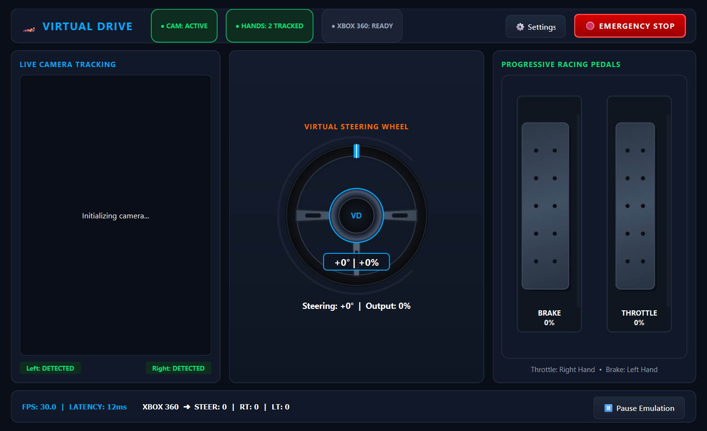
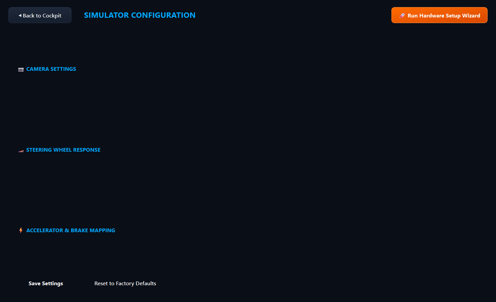
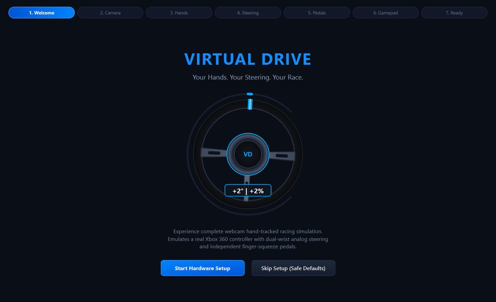
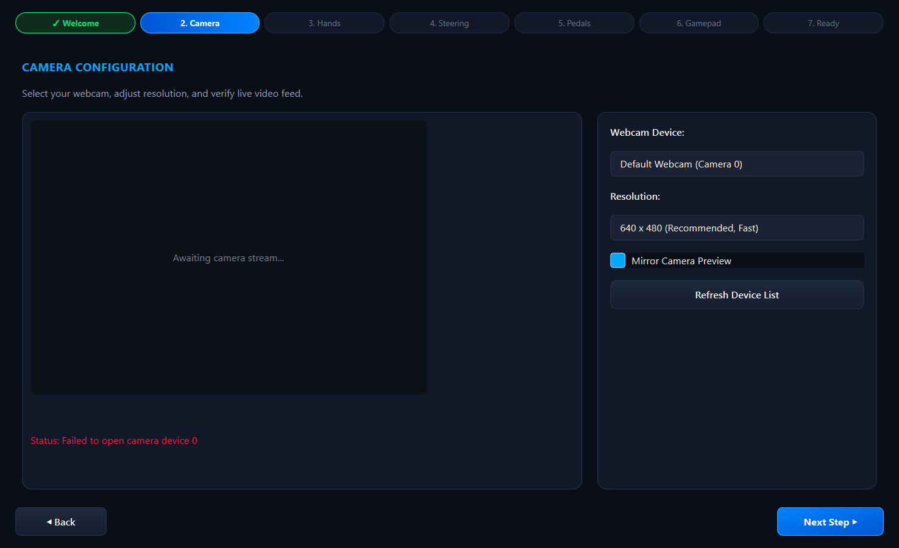
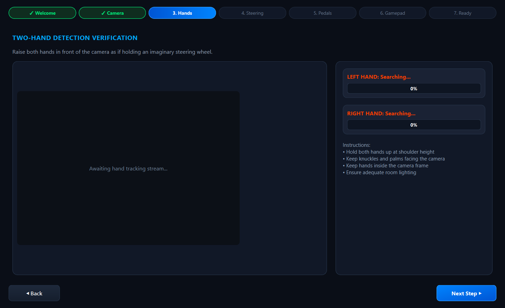
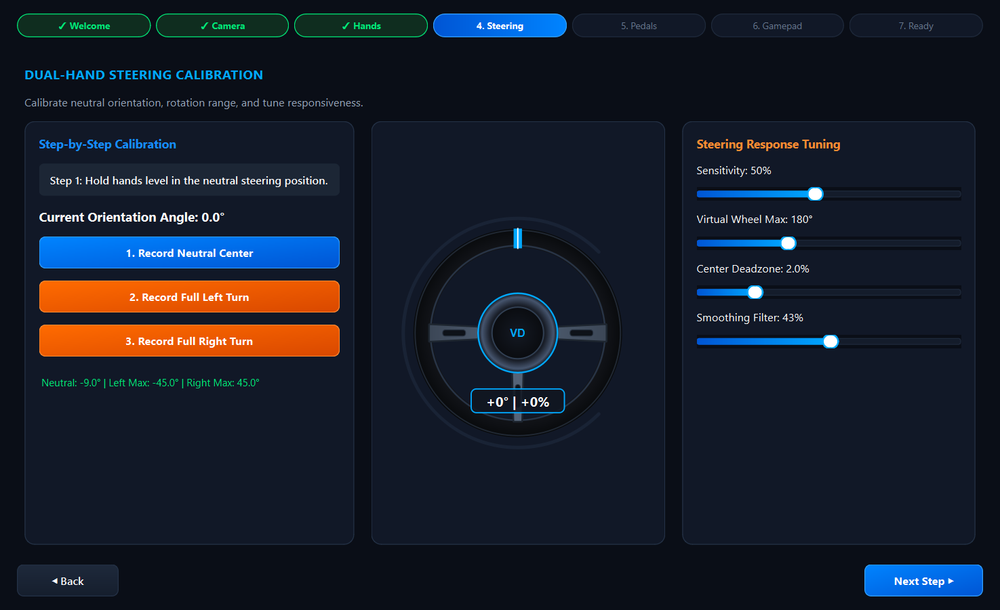
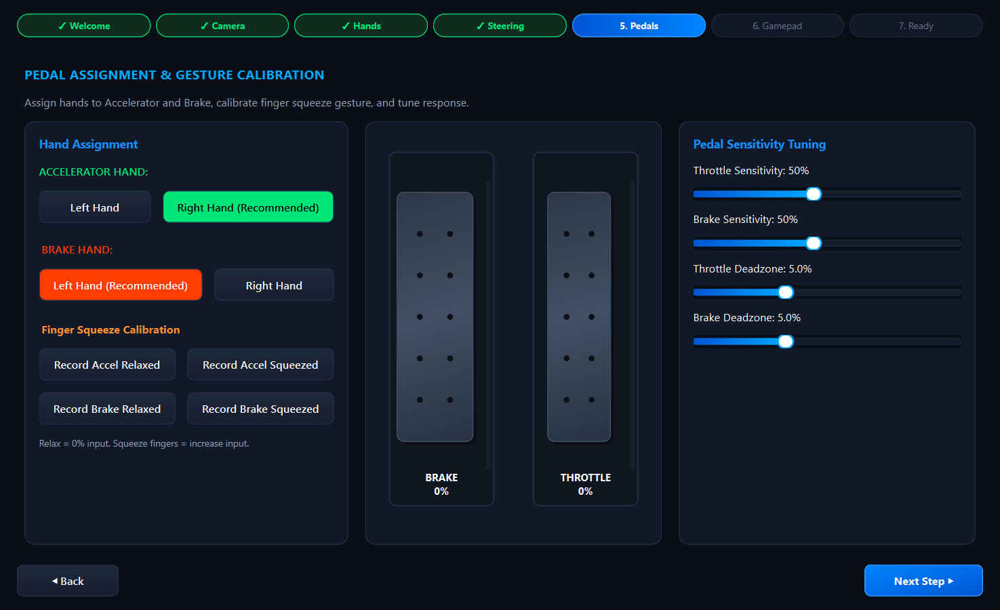
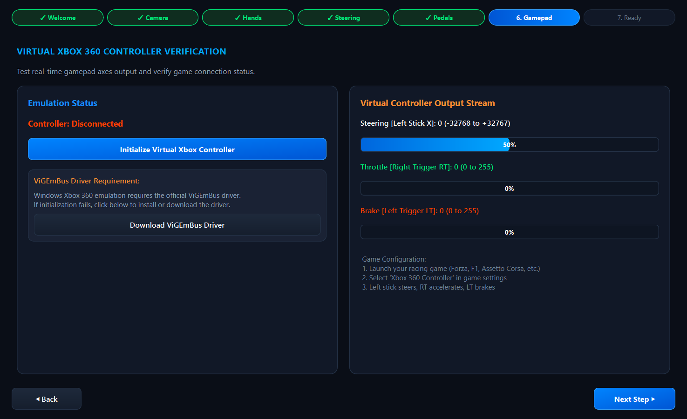
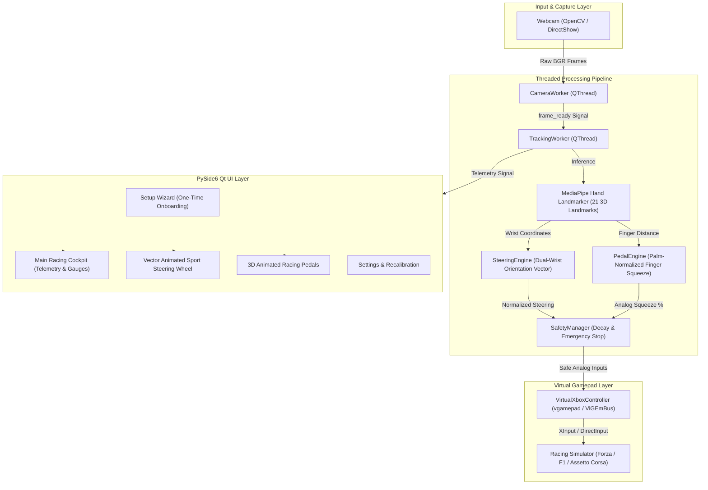
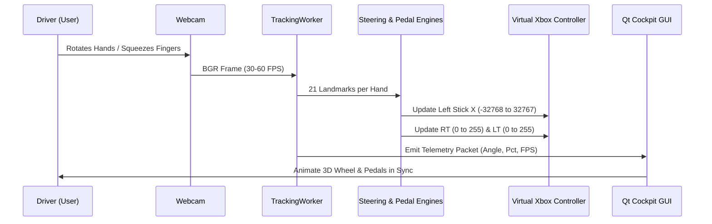

# 🏎️ VIRTUAL DRIVE — Virtual Racing Simulator Controller

[](LICENSE)
[]()
[]()
[]()
[]()

> **Your Hands. Your Steering. Your Race.**  
> A high-performance Windows desktop racing simulator controller that uses your laptop webcam and computer vision to track both hands and emulate a physical **Xbox 360 Controller** in real-time.

---

## 📸 Application Showcase

### Cockpit Dashboard & Settings
| Main Racing Cockpit | Runtime Settings & Calibration |
|:---:|:---:|
|  |  |

### First-Launch Hardware Setup Wizard
| 1. Welcome Screen | 2. Camera Configuration | 3. Dual-Hand Detection |
|:---:|:---:|:---:|
|  |  |  |

| 4. Dual-Hand Steering Setup | 5. Pedal Gesture Calibration | 6. Gamepad Axis Verification |
|:---:|:---:|:---:|
|  |  |  |

---

## ⚡ Key Highlights

- **Dual-Hand Wrist Steering**: Hold hands in front of the camera as if gripping a physical steering wheel. The application measures the vector orientation between left and right wrists to produce true rotational steering angle.
- **Progressive Finger-Squeeze Pedals**: Independent hand assignments for Throttle and Brake. Gently squeeze thumb and middle finger to modulate acceleration and braking (0–100%).
- **Virtual Xbox 360 Controller Emulation**: Emulates native Microsoft Xbox 360 hardware via `vgamepad`:
  - **Steering**: Left Stick X Axis (`-32,768` Full Left to `+32,767` Full Right)
  - **Throttle**: Right Trigger RT (`0` Released to `255` Max)
  - **Brake**: Left Trigger LT (`0` Released to `255` Max)
- **One-Time Onboarding Wizard**: Guided 7-stage configuration wizard that saves your preferences in `config.json` and automatically opens directly into the racing dashboard on all subsequent launches.
- **Fail-Safe Safety System**: Immediate pedal release on hand loss, smooth centering decay, dedicated red **Emergency Stop** button, and global `ESC` keyboard kill-switch.

---

## 🏛️ System Architecture



### Signal Flow Architecture


---

## 📁 Repository Structure

```
virtual-controller/
├── main.py                     # Application entry point & thread lifecycle
├── requirements.txt            # Python dependencies
├── config.json                 # Persistent configuration settings
├── LICENSE                     # MIT License
├── README.md                   # Comprehensive documentation
│
├── core/
│   ├── camera_manager.py       # Threaded OpenCV capture & backend management
│   ├── hand_tracker.py         # MediaPipe Tasks vision hand tracking
│   ├── hand_assignment.py     # Independent pedal hand mapping manager
│   ├── steering_engine.py      # Dual-wrist vector orientation & steering logic
│   ├── pedal_engine.py         # Palm-normalized finger squeeze pedal logic
│   ├── calibration_manager.py  # Steering & gesture range calibration
│   ├── sensitivity_manager.py  # Response curves, deadzones, and multipliers
│   ├── smoothing.py            # Low-pass EMA filter & deadzone mapping
│   ├── virtual_controller.py   # vgamepad Xbox 360 emulator & ViGEm interface
│   └── safety_manager.py       # Emergency stop & tracking loss fail-safes
│
├── ui/
│   ├── styles.py               # Motorsport dark theme palette & stylesheets
│   ├── steering_wheel.py       # Custom QPainter vector racing wheel widget
│   ├── pedal_visualization.py  # Custom QPainter animated pedals widget
│   ├── welcome_screen.py       # Wizard Screen 1: Welcome
│   ├── camera_setup.py         # Wizard Screen 2: Camera resolution & preview
│   ├── hand_setup.py           # Wizard Screen 3: Dual-hand detection
│   ├── steering_setup.py       # Wizard Screen 4: Steering calibration & tuning
│   ├── pedal_setup.py          # Wizard Screen 5: Throttle & brake setup
│   ├── controller_test.py      # Wizard Screen 6: Gamepad axis verification
│   ├── setup_wizard.py         # Wizard container with stepper breadcrumb
│   ├── main_dashboard.py       # Main telemetry cockpit dashboard
│   └── settings_page.py        # Settings & recalibration dialog
│
├── utils/
│   ├── config_manager.py       # Safe JSON configuration loader/saver
│   ├── logger.py               # Application logging utility
│   └── diagnostics.py          # Real-time FPS and latency tracking
│
├── assets/
│   ├── models/
│   │   └── hand_landmarker.task # MediaPipe Hand Landmarker model file
│   ├── icons/
│   ├── fonts/
│   └── sounds/
│
├── docs/
│   └── screenshots/            # High-resolution screenshots of every page
│
├── tests/
│   ├── test_steering.py        # Steering calculation & deadzone unit tests
│   ├── test_pedals.py          # Finger squeeze & palm normalization tests
│   ├── test_calibration.py     # Calibration & outlier rejection tests
│   ├── test_hand_assignment.py # Hand assignment validation tests
│   ├── test_controller.py      # Controller axis mapping unit tests
│   ├── test_wizard_flow.py     # Setup completion & view routing tests
│   └── test_app_launch.py      # Application lifecycle & threading tests
│
└── packaging/
    └── virtual_drive.spec      # PyInstaller spec for Windows EXE creation
```

---

## 🚀 Quick Start Guide

### 1. Prerequisites
- **Windows 10 / 11 (64-bit)**
- **Python 3.11+**
- **ViGEmBus Driver**: Required for Windows virtual gamepad emulation.
  - Download and install the [ViGEmBus Setup Executable](https://github.com/ViGEm/ViGEmBus/releases/latest).

### 2. Installation
```powershell
# Clone the repository
git clone https://github.com/ABIZER-web/virtual-controller.git
cd virtual-controller

# Install dependencies
pip install -r requirements.txt
```

### 3. Run the Application
```powershell
python main.py
```

---

## 🎮 Game Configuration Guide

Compatible with racing simulators that support standard Xbox 360 gamepads:
- **Forza Horizon 4 / 5 & Forza Motorsport**
- **F1 22 / 23 / 24**
- **Assetto Corsa & Assetto Corsa Competizione**
- **Project CARS 2 / 3**
- **Dirt Rally 2.0 & EA Sports WRC**
- **Need for Speed Series**

### In-Game Setup Steps:
1. Start **VIRTUAL DRIVE** and complete calibration.
2. Launch your racing simulator.
3. Go to **Settings > Controls / Controller Settings**.
4. Select **Xbox 360 Controller**.
5. Bind Controls:
   - **Steering**: Left Analog Stick X
   - **Throttle**: Right Trigger (RT)
   - **Brake**: Left Trigger (LT)
6. Hit the track! Press `ESC` or click **Emergency Stop** at any time to instantly zero all controller inputs.

---

## 🧪 Automated Test Suite

Run all 24 unit and integration tests:
```powershell
python -m unittest discover tests
```
```
........................
----------------------------------------------------------------------
Ran 24 tests in 0.793s

OK
```

---

## 📦 Building Standalone Windows Executable

To compile into a standalone Windows `.exe`:
```powershell
cd packaging
pyinstaller virtual_drive.spec
```
The output executable will be generated in `packaging/dist/VirtualDrive/`.

---

## 📄 License

This project is licensed under the **MIT License** — see the [LICENSE](LICENSE) file for details.

Copyright (c) 2026 **ABIZER-web**
